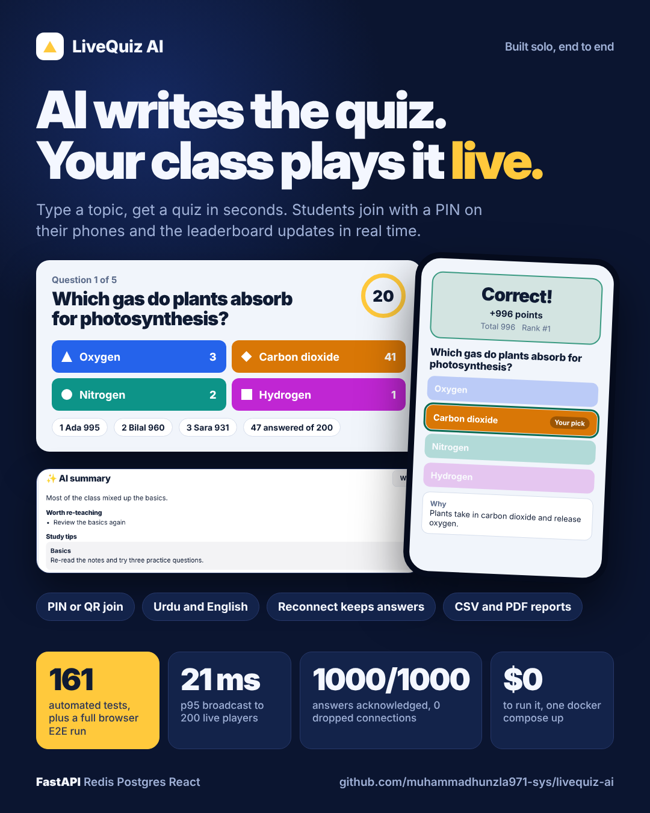
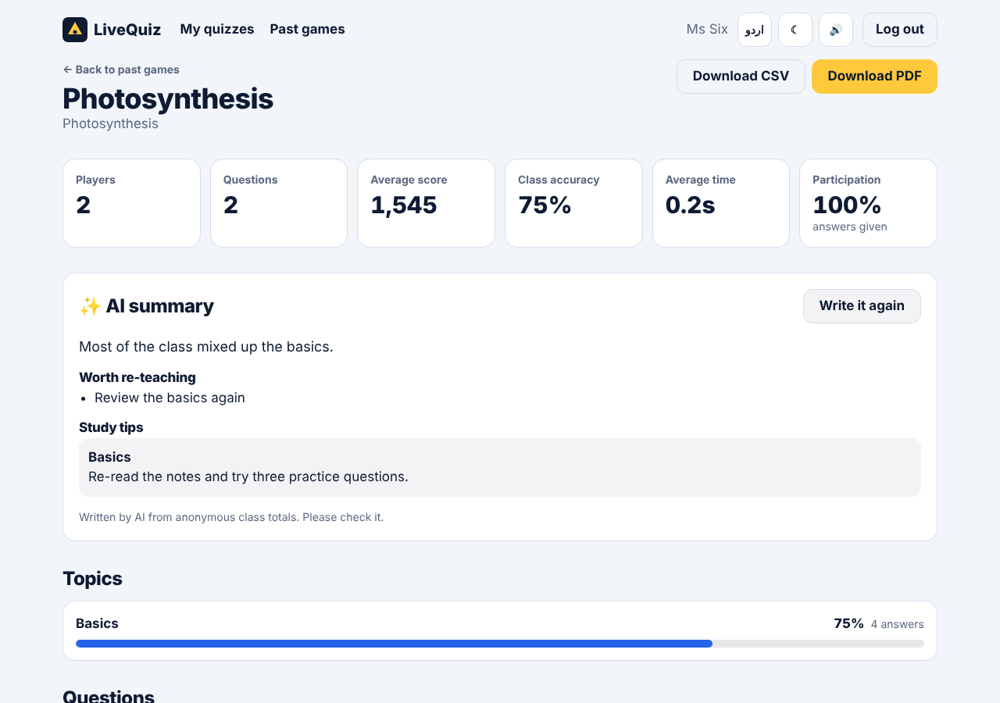
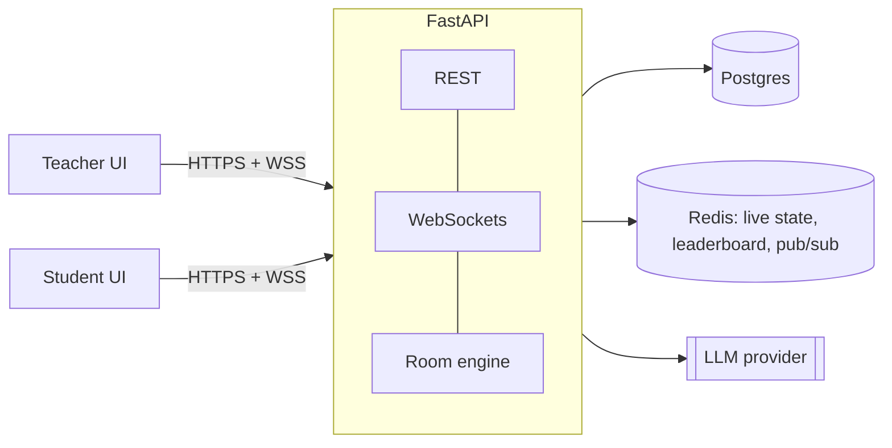

# LiveQuiz AI

**AI writes the quiz. Your class plays it live.**

A real-time classroom quiz platform. A teacher types a topic and AI writes the quiz. Students join
from their phones with a PIN or QR code and play together with a live leaderboard. Afterwards the
teacher gets a report with the hardest questions, weak topics and an AI-written summary.




## Features
- **AI quiz generation**: plan, write, validate and retry, with live progress (SSE). Works in several languages.
- **Live games over WebSockets**: PIN or QR join, timer, answer counts, pause, end early, kick player.
- **Fair scoring**: computed on the server only (speed, streak, partial credit for multi-select).
- **Reconnect safe**: a student who loses signal returns to the same game without losing answers.
- **Teacher reports**: class, topic, question and student stats, AI summary, CSV and PDF export.
- **English and Urdu** with right-to-left layout, dark mode and sound toggle.
- **Hardened**: rate limits, account lock, log redaction, body size cap, prod startup guard, `/metrics`.



## How it was verified
| What | Result |
|---|---|
| Backend tests (ruff, mypy, pytest) | 116 passed |
| Frontend tests (vitest) | 45 passed |
| Browser E2E (Playwright): 1 teacher, 3 students, full game and report | passed |
| Load test: 200 players, 5 questions, real Redis | p95 broadcast 21 ms, 1000/1000 answers acknowledged |

## Architecture

More detail: [docs/ARCHITECTURE.md](docs/ARCHITECTURE.md).

## Run it locally (Docker)
```bash
cp .env.example .env            # then set JWT_SECRET and LLM_API_KEY inside
docker compose up -d --build    # API + Postgres + Redis on :8000 (migrations run automatically)
cd frontend
npm install
npm run dev                     # http://localhost:5173
```
Optional demo data: `docker compose exec api python -m app.seed`
(teacher `demo@livequiz.ai`, password `demo-password-123`).

Without an `LLM_API_KEY` everything works except AI generation and the AI summary (quizzes can be
built by hand). Free Groq key: console.groq.com.

## Environment variables
| Variable | Meaning |
|---|---|
| `ENV` | `dev` or `prod` (prod refuses unsafe settings) |
| `JWT_SECRET` | long random string; `python -c "import secrets; print(secrets.token_urlsafe(48))"` |
| `DATABASE_URL`, `REDIS_URL` | set by docker-compose / Render |
| `CORS_ORIGINS`, `FRONTEND_URL` | the frontend URL |
| `LLM_API_KEY`, `LLM_BASE_URL` | LLM provider (default Groq) |
| `LLM_PRIMARY_MODEL`, `LLM_FALLBACK_MODEL` | default `openai/gpt-oss-120b` / `openai/gpt-oss-20b` |
| `TRUSTED_PROXY_HOPS` | reverse proxies in front of the API (1 on Render, 0 locally) |
| `GENERATION_RATE_PER_HOUR`, `JOIN_RATE_PER_MIN`, `MAX_PLAYERS_PER_ROOM` | limits |
| `METRICS_TOKEN` | if set, `/metrics` needs `Authorization: Bearer <token>` |
| `VITE_API_URL` (frontend) | backend URL in production; empty locally |

Full list with defaults: `backend/app/core/config.py`.

## Scoring
```
points = base × accuracy × speed × streak
accuracy = 1 for a fully correct answer; multi-select: max(0, (right − wrong) / total correct)
speed    = 0.5 + 0.5 × (time remaining / time limit)
streak   = 1 + min(0.1 × previous streak, 0.5)      (only fully correct answers extend a streak)
```
Defaults: base 1000. Computed on the server only; the client never sends a score or a time.
Late answers (after a 500 ms network grace) are rejected; the first answer wins.

## Tests
```bash
cd backend  && pip install -e ".[dev]" && ruff check . && mypy app && pytest -q   # 116 tests
cd frontend && npm test && npx tsc --noEmit && npm run lint                       # 45 tests
cd frontend && npx playwright install chromium && npm run e2e                     # needs `docker compose up`
```
CI (`.github/workflows/ci.yml`) runs all of it on every push.

## Load test
```bash
# put JOIN_RATE_PER_MIN=1000 in .env (all simulated players share one IP), then:
docker compose up -d --force-recreate api
python backend/loadtest/ws_load.py --base http://localhost:8000 --players 200 --questions 5
```
Result (one machine, real Redis, 200 players, 5 questions, 1000 answers):

| Measure | p50 | p95 | max |
|---|---|---|---|
| Question broadcast (server send → client receive) | 12.5 ms | 21.4 ms | 23.2 ms |
| First → last player receiving the same question | 17.6 ms | 20.5 ms | 20.5 ms |
| Answer acknowledgement | 16 ms | 154 ms | 259 ms |

1000 of 1000 answers acknowledged, 0 unexpected disconnects. Target was p95 < 300 ms. This is a
local number; over the internet add network latency.

## Deploy
Render (API + Postgres + Redis) and Vercel (frontend): step by step in
[docs/DEPLOYMENT.md](docs/DEPLOYMENT.md).

## Docs
[PROTOCOL](docs/PROTOCOL.md) (every WebSocket event) · [API](docs/API.md) (REST; Swagger at `/docs`) ·
[ARCHITECTURE](docs/ARCHITECTURE.md) · [DECISIONS](docs/DECISIONS.md) ·
[ROADMAP + requirement checklist](docs/ROADMAP.md)

## 3-minute demo script
1. **(20 s)** Sign up, click **Create a quiz**, type "Photosynthesis", pick 10 questions, **Generate**.
   Say: AI plans, writes, validates and retries the questions.
2. **(20 s)** Show the editor: change one answer, regenerate one question. **Save and publish → Launch live.**
3. **(30 s)** Show the big-screen lobby with the PIN and QR. Join with two phones (or two private tabs).
4. **(60 s)** Start. Answer on the phones; show the speed bonus, the live distribution and the
   leaderboard. Pause once, then reload a phone: its answer is still locked in.
5. **(30 s)** End the game: podium, student result card and answer review.
6. **(40 s)** **View full report**: hardest questions, weak topics, students who need support,
   **AI summary**, CSV/PDF export.
