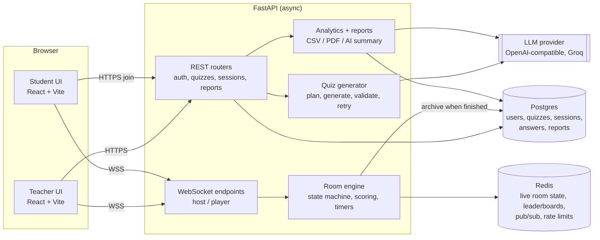

# Architecture



## The two halves

**Authoring and records (REST + Postgres).** Teachers register, create quizzes (by hand, from CSV,
or with AI), publish them, launch games and read reports. This is ordinary CRUD with
SQLAlchemy 2 (async) and Alembic migrations.

**The live game (WebSocket + Redis).** While a game runs, *everything* about it lives in Redis, not
in process memory and not in Postgres: room state, the question list, every player, answers, the
leaderboard (a sorted set). This is what lets a refreshed or reconnecting student pick up exactly
where they were, and what lets more than one API instance serve the same room. When the game
finishes, the engine writes the results to Postgres in one archive step, and reports are built
from Postgres from then on.

## Request flow of one question

1. Host sends `host.next`. The engine checks the state machine, loads the next question from Redis,
   sets `question_end_at` (server time) and publishes `question.show` to the room's Redis channel.
2. Every API instance holding sockets for that room receives the message from pub/sub and writes
   it to its local connections (each with its own bounded send queue, so one slow phone cannot
   stall the room).
3. A student sends `player.answer`. The engine checks the server clock, the question id, the
   options and "first answer wins", computes the score (`services/scoring.py`) and writes the
   answer, distribution and leaderboard in Redis. The client never sends a score or a time.
4. When the timer ends or everyone has answered, the engine closes the question and sends
   `answer.reveal` and `leaderboard.update`.

One instance at a time owns a room's timer through a short Redis lease; if it disappears another
instance takes over.

## Code map

```
backend/app/
  api/        auth, quizzes (+ AI generation, CSV), sessions (+ join), reports, deps
  ws/         protocol.py (message names and models), manager.py (connections + pub/sub), endpoints.py
  services/   room_engine.py, state_machine.py, scoring.py, quiz_generation.py,
              analytics.py, moderation.py, quiz_csv.py
  llm/        provider.py (OpenAI-compatible client), retry.py (validate + retry), prompts/
  core/       config, security (argon2, JWT), rate_limit, redis (bounded pool), logging, metrics, net
  models/ schemas/ db/
frontend/src/
  pages/ features/{host,play,quiz-editor,reports}/ ws/ store/ i18n/ lib/ components/
```

## Security model

- Passwords: argon2. Access token 15 min, refresh token 14 days (stored hashed, rotated on use).
  Students get a separate short-lived player token scoped to one room; a player token can never
  call teacher endpoints and the reverse.
- Role, time and score are decided on the server only.
- Rate limits (Redis counters): login (per IP and per account), registration, token refresh, joining,
  PIN guessing lockout, AI generation per teacher, AI summary. WebSockets have a per-socket
  message rate and a maximum message size.
- X-Forwarded-For is only trusted for the number of proxies we run behind (`TRUSTED_PROXY_HOPS`).
- Student nicknames and quiz topics pass through moderation; CSV exports neutralise formula injection.
- Security headers, body-size limit, no stack traces in responses, tokens redacted from logs.
- In production the app refuses to start with a default `JWT_SECRET` or wildcard CORS.

## Observability

Structured JSON logs with a request id, `/health` (is the process up), `/ready` (are Postgres and
Redis reachable) and `/metrics` (Prometheus text format: HTTP counts and time, LLM calls, tokens
and seconds, active rooms, connected players). Set `METRICS_TOKEN` to require a bearer token.

## LLM layer

`LLMProvider` is a small interface over any OpenAI-compatible endpoint (Groq by default).
Quiz generation is plan → generate → validate (Pydantic rules: unique options, no "all of the
above", exactly one correct answer for MCQ, …) → retry the failures with feedback → fall back to
the second model. If the LLM is down the teacher is told so and can build the quiz by hand;
previously generated quizzes (cached by request hash) keep working.
